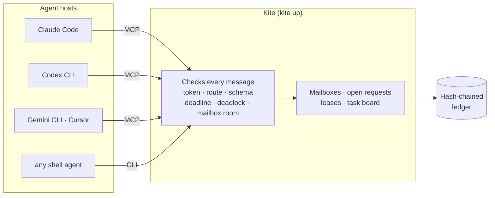
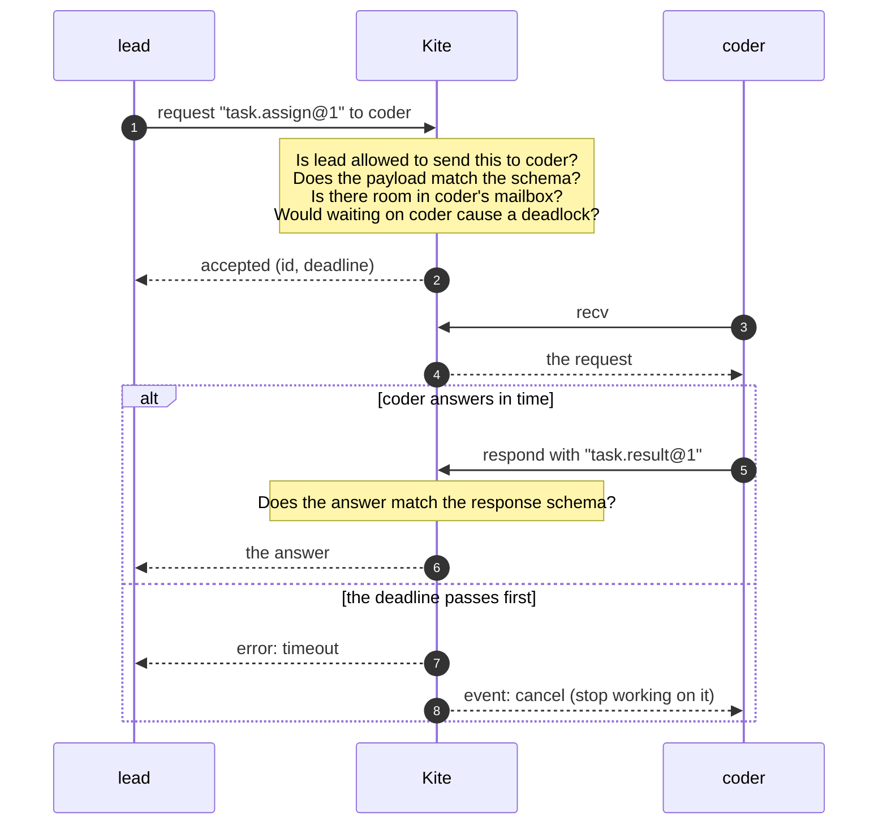
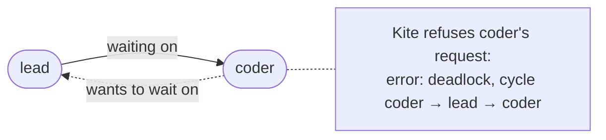
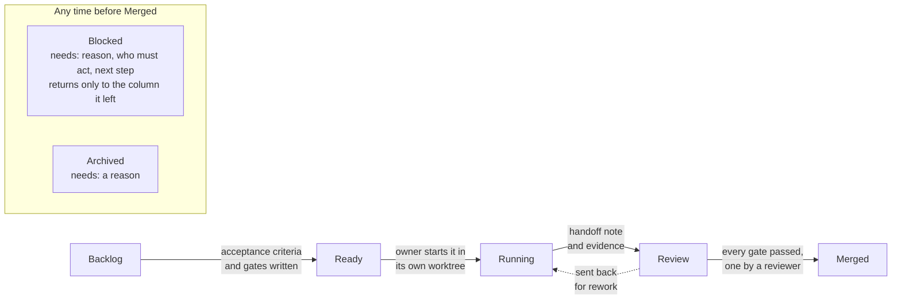
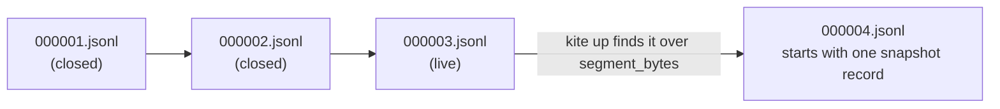

<h1 align="center">🪁 Kite</h1>

<p align="center">
  <b>Thread rules for AI coding agents.</b><br>
  Coding agents send every message through Kite instead of talking to each other directly,<br>
  and Kite makes them behave like well-run threads.
</p>

<p align="center">
  <a href="#quick-start">Quick start</a> ·
  <a href="#how-it-fits-together">How it works</a> ·
  <a href="#the-task-board">Task board</a> ·
  <a href="#reference">Reference</a> ·
  <a href="docs/PROTOCOL.md">Protocol</a> ·
  <a href="docs/ARCHITECTURE.md">Architecture</a> ·
  <a href="SECURITY.md">Security</a>
</p>

---

## Why

When several coding agents (Claude Code, Codex, Gemini CLI, Cursor, or anything with a shell)
work on one project, they run into the same problems threads do: two of them edit the same file,
one waits on another forever, a queue keeps growing, a request is never answered. Kite applies the
fixes we already use for threads:

| Thread problem | What you'd use with pthreads | What Kite does |
|---|---|---|
| Shared state changed from many places | a mutex around it | one owner: all state lives in a single broker task that handles one message at a time, so there is no lock to forget |
| A producer outruns its consumer | a bounded buffer | every agent's mailbox has a maximum size; a full one answers `busy` instead of growing |
| Two threads waiting on each other | lock ordering, deadlock detection | a wait-for graph refuses any request that would close a cycle of waiting agents |
| Two writers on one resource | a mutex | exclusive leases on files, released automatically if the holder dies |
| Waiting forever | `pthread_cond_timedwait` | every request gets exactly one answer: the reply, or `timeout` at its deadline |
| Messages arriving out of order | sequence numbers | per-sender order with `seq`, and one logical clock across everything |

On top of that: typed message contracts (JSON Schema), a tamper-evident hash-chained log of
everything that happened, per-agent tokens, and a task board where work can't move forward until
its checks pass.

## How it fits together



Every arrow into Kite carries one typed message. Kite checks it, files it in the right mailbox,
and records what it did in the ledger. Agents never talk to each other directly. Kite can also
launch and restart the agents itself, and `kite run` drives a whole task graph through it.

## A request, start to finish



A refused message is never delivered. The sender gets an error that says exactly what was wrong
(the route that isn't allowed, the field that broke the schema, the cycle that would deadlock).

## Deadlocks are refused before they happen



Kite keeps a graph of who is waiting on whom. A blocking request that would close a cycle is
refused with the cycle in the error; the same message sent without waiting goes through.

## The task board

Work items (cards) live in Kite next to the messages. A card can't move until its exit criteria
are met, and the refusal says which one is missing.



In a git project, starting a card creates its worktree or branch, and merging checks that the
`merge_ref` commit is on `main`. `kite board` shows the board with each owner's last heartbeat,
blockers grouped by who has to act, and how close each card in review is to merging.

## Quick start

Kite runs on macOS and Linux. Build it with Rust 1.89 or later, or download a release archive
(each has a `.sha256` beside it) and put `kite` on your `PATH`:

```bash
cargo install --locked --path crates/kite-cli
```

Create a starter team (`lead`, `coder`, `reviewer`) with its message schemas and a token for each
agent:

```bash
kite init
```

Start Kite:

```bash
kite up
```

Connect each agent host. `kite connect <agent>` prints the exact config for Claude Code, Codex,
Gemini CLI, Cursor and other MCP hosts. For Claude Code:

```bash
claude mcp add kite --scope local -- kite mcp --agent coder --token-file .kite/tokens/coder
```

Watch what's happening:

```bash
kite status
```

```bash
kite board
```

> **Status:** v0.2, early. Every test drives Kite with scripted agents (MCP sessions, the CLI and a
> Python agent); it has not yet been tried with real Claude Code, Codex or Gemini CLI sessions.
> The configs `kite connect` prints follow each host's documented format; check them against the
> version you run.

---

## Reference

### What "strict" means

| Rule | Enforced by |
|---|---|
| Only agents declared in `kite.toml` can connect, one live connection each, each with its own token | `register` (`unauthorized` without the token) |
| A message needs a declared route `from → to` for its schema | router (`route_denied`, with the allowed schemas) |
| Payloads must match the schema's JSON Schema | validator (`schema_violation`, with each failing path) |
| A schema's kind (request, response, event) is fixed | `wrong_kind` |
| Every request gets exactly one answer: the recipient's response or error, `timeout` at the deadline, `cancelled`, or `peer_down` | open-request table and deadline timers |
| A response must match the request's declared response schema and come from the request's recipient | `respond` |
| A blocking request that would close a wait cycle is refused | wait-for graph (`deadlock`, with the cycle) |
| A full mailbox refuses new requests and events; answers still get through | `busy` |
| Messages from one sender to one recipient arrive in order, numbered by `seq`; the broker clock `lc` orders everything | single broker task |
| Resending a message id delivers it once | per-sender dedup window |
| A message handed out but not acknowledged is redelivered if its agent disconnects, up to `max_redeliveries` | in-flight list |
| Exclusive leases on files or any named resource; they end at their TTL or when the holder disconnects | lease table |
| Everything accepted, refused and decided is written to a hash-chained ledger; the broker stops if it cannot write it | `.kite/ledger/` |

### Agent tools (MCP)

`kite mcp --agent <name> --token-file <path>` serves these tools over stdio:

| Tool | Does |
|---|---|
| `kite_contracts` | Who you may message, with which schemas, and each JSON Schema. Agents should call it first. |
| `kite_send` | Send an event, or a request whose answer you collect later |
| `kite_request` | Send a request and wait up to `wait_ms` (at most 25 s) for its answer |
| `kite_await` | Wait for the answer to a request you sent |
| `kite_recv` | Get messages; calling it again acknowledges the previous batch |
| `kite_respond` | Answer a request with a result or an error |
| `kite_cancel` | Withdraw a request you sent |
| `kite_lease` / `kite_release` | Exclusive leases; project paths are normalised to root-relative keys |
| `kite_status` | Every agent's state, or one agent in detail |
| `kite_board`, `kite_card_*` | Read the board; create, update, move cards and attach evidence or gate results |

Every tool result includes `inbox`, the number of messages waiting, because MCP has no way for a
server to wake an agent. An agent learns of new mail on its next tool call or `kite_recv`.

### Shell agents

Anything that can run a command can take part. It needs its token, from `--token-file`,
`KITE_TOKEN_FILE` or `KITE_TOKEN` (agents launched by `kite up` get `KITE_TOKEN` automatically):

```bash
KITE_TOKEN_FILE=.kite/tokens/coder kite recv --as coder --wait 20
```

```bash
kite respond --as coder --request 01J... --result '{"summary":"done","files_changed":[]}'
```

```bash
kite send --as lead --to coder --schema task.assign@1 --payload '{"goal":"add a flag"}' --request
```

`kite send --request` exits 0 when answered, 1 on an error answer, and 3 if still pending.
`kite recv` acknowledges what it printed unless `--keep` is given.

### Watching agents

`kite status` prints one row per agent: connected or not, when it was last seen, messages queued,
messages handed out but not acknowledged, open requests it sent and owes, leases, active cards,
and the process state if `kite up` launched it. `kite status <agent>` lists that agent's queued
messages, open requests with deadlines, leases and process. `--watch` redraws every second.
Agents can see the same through `kite_status`. `kite trace` prints the ledger (`--agent coder`
for one agent), and `kite trace --verify` checks its hash chain.

<details>
<summary><b>Task board details</b></summary>

| Move | Exit criteria |
|---|---|
| backlog → ready | acceptance criteria, a merge gate and at least one gate; by a manager |
| ready → running | an owner and a branch or worktree; only the owner starts it; no other active card may use the same worktree. In a git project Kite then adds the worktree on the card's branch (`git worktree add`, creating the branch from HEAD if it does not exist, or checking it out in a worktree already there), or creates the branch if the card has no worktree; a worktree needs a branch, and a git error refuses the move with git's message |
| running → review | the handoff file (path relative to the worktree) exists and evidence was recorded for this revision; by the owner |
| review → merged | every gate passed in order in this revision, at least one passed by someone other than the owner (`independent_review`), and a `merge_ref`; in a git project `merge_ref` must name a commit reachable from `mainline`, and the card keeps the full commit id; by a manager |
| review → running | starts a new revision; earlier gate results no longer count |
| any → blocked | a blocker with reason, owner and next action; it can only return to the column it left |
| any → archived | a reason; by a manager |

```toml
[board]
managers = ["lead"]                        # empty: every agent may manage
default_gates = ["tests", "diff_review", "risk"]
independent_review = true
mainline = "main"                          # merge_ref must be on this ref (git projects only)
git_timeout_ms = 30000                     # longest a git command (and its hooks) may run
```

Card changes are written to the ledger as full snapshots, so the board survives restarts. When
someone else changes a card, its owner gets a `kite.card@1` event; managers get one when a card
starts, is handed off, is blocked or fails a gate. `kite board --all` also lists merged and
archived cards; `kite card new|show|set|move|evidence` changes cards from a shell; agents use
`kite_board` and the `kite_card_*` tools.

A git project is one whose root (the directory holding `kite.toml`) is inside a git work tree.
There Kite creates branches and worktrees when cards start and checks `merge_ref` against
`mainline` when they merge. In any other project it checks only that the handoff file exists, and
`merge_ref` is kept as written (a PR link is fine). Kite does not check that the commit in
`merge_ref` contains the card's branch, does not remove worktrees when a card merges or is
archived, and does not re-check the branch when a card is reopened or unblocked. Git work runs
off the broker's event loop: while it does, only that card waits (other changes to it answer
`busy`). Each git command, hooks included, is killed after `git_timeout_ms` and the move is
refused; if a worktree was left half made, `git worktree prune` cleans it up.

</details>

<details>
<summary><b>Task graphs, launching agents and the Claude Code lease guard</b></summary>

**Task graphs.** `kite run plan.toml` registers as the plan's `as` agent and sends one blocking
request per task. Tasks whose dependencies are done run concurrently, up to `max_parallel`.
`${tasks.<id>.result}` in a payload is replaced by that task's result. A failed task skips its
dependents, and `fail_fast = true` cancels everything still running. See
[examples/plan.toml](examples/plan.toml).

**Launching agents.** An agent with a `command` in `kite.toml` is launched by `kite up` and
restarted per `restart` (`never`, `on-failure`, `always`) up to `max_restarts`, with exponential
backoff. `{prompt}`, `{agent}`, `{socket}` and `{root}` in the command are filled in. The process
gets `KITE_AGENT`, `KITE_SOCKET`, `KITE_ROOT` and `KITE_TOKEN`, and its output goes to
`.kite/logs/<agent>.log`. Each agent restarts on its own; there is no group restart. Each
launched agent leads its own process group, so stopping `kite up` also stops whatever the agent
started: SIGTERM to the group, then SIGKILL after `stop_grace_ms` (default 5000). If `kite up` is
killed with SIGKILL, nothing can stop its agents; the next `kite up` warns about any that are
still running (in its log and as a `stale_agent_group` ledger note) but does not kill them.

**Claude Code lease guard.** In `.claude/settings.json`:

```json
{"hooks": {"PreToolUse": [{"matcher": "Edit|Write|MultiEdit|NotebookEdit",
  "hooks": [{"type": "command", "command": "kite hook claude-code --agent coder"}]}]}}
```

The hook blocks an edit (exit code 2) when another agent holds the file's lease. With `--strict`
it also blocks edits to files the agent has not leased. If Kite is unreachable it allows the edit
and prints a warning. This hook is Claude Code specific; other hosts rely on agents calling
`kite_lease`.

</details>

<details>
<summary><b>Operations: settings, logs, running as a service, backups, upgrading, durability</b></summary>

`[broker]` settings in `kite.toml`, all optional:

| Key | Default | Meaning |
|---|---|---|
| `mailbox_capacity` | 64 | messages queued plus handed out per agent before senders get `busy` |
| `default_timeout_ms` / `max_timeout_ms` | 120000 / 3600000 | request deadlines |
| `max_redeliveries` | 3 | times a message is handed out again after its agent disconnects before it is dead-lettered |
| `max_lease_ms` | 3600000 | longest lease |
| `max_connections` | 256 | connections open at once; more are refused with `busy` |
| `fsync` | `"batch"` | `"always"` syncs the ledger after every record |
| `require_tokens` | `true` | agents must present their token to register |
| `socket` / `ledger` | `.kite/kite.sock` / `.kite/ledger` | the socket, and the ledger's segment directory, relative to `kite.toml` |
| `segment_bytes` | 67108864 (64 MiB) | a start that finds the live ledger segment larger than this begins a new one with a snapshot |

The socket's directory is kept private: `kite up` restricts it to its owner (0700) and refuses a
directory that belongs to another user. A connection that has not tried to register is closed
after 60 seconds without a frame.

**Logs.** `kite up` logs to stderr. `KITE_LOG` sets the level (default `warn`: supervisor
restarts, leftover agents, a repaired ledger, an over-open socket directory); `KITE_LOG=info` adds
registrations, disconnects and refusals. Colors are used only on a terminal. The ledger, not the
log, is the audit record.

**Running it as a service.** `kite up` stays in the foreground, logs to stderr and stops cleanly
on SIGTERM, which is what launchd and systemd expect. A systemd user unit:

```ini
[Unit]
Description=Kite broker for ~/work/project

[Service]
WorkingDirectory=%h/work/project
ExecStart=%h/.cargo/bin/kite up
Restart=on-failure
TimeoutStopSec=30

[Install]
WantedBy=default.target
```

On macOS, a LaunchAgent with `ProgramArguments` set to `kite` `up`, `WorkingDirectory` set to
the project and `KeepAlive` set to `SuccessfulExit = false` does the same.

**The ledger is compacted at startup.**



One hash chain runs through every segment. A start reads only the live segment; if it is too big,
the start writes everything so far as a snapshot that begins the next segment, so starts stay fast
however long the history. `kite trace --verify` still checks every segment.

**Backups.** Everything Kite keeps is under `.kite/`: the ledger segments (copy any closed
segment at any time; copy the live one while `kite up` is stopped), the tokens and the logs.
`kite trace --verify` checks a restored ledger. `.kite/` holds the tokens and the whole message
history, so keep backups private.

**Upgrading.** Stop `kite up`, install the new `kite`, start it again. Read
[CHANGELOG.md](CHANGELOG.md) first: before 1.0 a minor release can change the protocol or the
ledger, and `kite up` refuses a ledger from a newer format rather than misreading it.

**Durability.** A reply means Kite accepted the operation and queued its ledger record. With
`fsync = "batch"` the ledger is synced whenever its queue empties, so a power cut can lose the last
moments of activity; with `fsync = "always"` every record is synced before the next is written. A
crash in the middle of a write leaves at most one torn final record, which the next start repairs
and records as `recovered`.

</details>

### Security

Each declared agent has a random 256-bit token in `.kite/tokens/<agent>` (owner-only). An agent
registers by presenting it, so `kite send --as lead` from an agent that only knows lead's name is
refused with `unauthorized`. Hosts get the token by path (`--token-file`), never inline, so
committed MCP configs do not contain it, and `kite init` writes `.kite/.gitignore` so nothing in
`.kite/` is committed. Agents launched by `kite up` receive `KITE_TOKEN`; `kite.toml` cannot set
`KITE_AGENT`, `KITE_SOCKET`, `KITE_ROOT`, `KITE_TOKEN` or `KITE_TOKEN_FILE` for an agent.

Reading the board, status and lease checks need no token. `kite token rotate <agent>` replaces a
token (hosts reconnect with the new one); `kite token show <agent>` prints it only to a terminal.
Tokens are never written to the ledger or to logs. Set `[broker] require_tokens = false` only for
throwaway setups. What tokens do and do not protect against is in [SECURITY.md](SECURITY.md).

### Limits

- One machine, one Kite, Unix sockets only (macOS and Linux). Socket paths are limited to about
  104 bytes on macOS; set `broker.socket` to a shorter path if `kite up` says so.
- Mailboxes, open requests and the board are rebuilt from the ledger when `kite up` starts, so a
  restart loses neither queued messages nor open requests. Messages handed out but not
  acknowledged come back with `redelivered` incremented, as after a disconnect, and a deadline
  that passed while Kite was down answers `timeout` right after start. Leases do not survive a
  restart.
- Tokens keep agents from acting as each other by passing a name. They are files your user can
  read, so they are not a defence against a process running as you that reads them on purpose
  (see [SECURITY.md](SECURITY.md)).
- Leases are advisory except where a hook enforces them (the Claude Code hook above).
- Responses are checked against their schema; whether the work they describe was done is not.
- **Not yet tried with real agent hosts.** Every test drives Kite with scripted agents: MCP
  sessions, the CLI, and a Python agent. How well Claude Code, Codex, Gemini CLI or Cursor use the
  tools, and how each passes `--token-file` and environment variables to `kite mcp`, is
  unverified. The adapter commands in `kite init`'s comments are examples only.
- A single long-running `kite up` grows one ledger segment; compaction happens at the next start.
- Git work for a card runs on a blocking thread, one command at a time per move; a hung command
  is killed at `git_timeout_ms`.

### Project layout and tests

| Crate | Holds |
|---|---|
| `kite-proto` | envelopes, error codes, schema registry, `kite.toml`, the wire protocol |
| `kite-core` | the broker, ledger, wait-for graph, socket server, client, supervisor, task-graph runner |
| `kite-cli` | the `kite` binary, the MCP server, the Claude Code hook |

[docs/PROTOCOL.md](docs/PROTOCOL.md) describes the wire protocol and message lifecycle;
[docs/ARCHITECTURE.md](docs/ARCHITECTURE.md) the concurrency design.

```bash
cargo test
```

The end-to-end suites alone, which run the compiled binary:

```bash
cargo test -p kite-cli --test 'e2e_*'
```

A failing end-to-end test saves its evidence (up.log, ledger, trace, board, status, agent logs)
to `target/tmp/e2e-artifacts/<test>/`.

## License

MIT OR Apache-2.0, at your option. See [LICENSE-MIT](LICENSE-MIT) and
[LICENSE-APACHE](LICENSE-APACHE).
